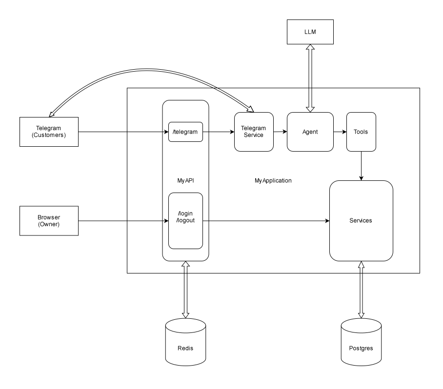

# Salon-Service

Salon-Service is a salon service provider with an AI assistant to help you with services. It can create automated bookings, display it, list available services and slots. Users can interact from the telegram messaging platform with the agent and seamlessly get the servicing actions performed. 

**Join telegram bot:** [bot link](https://t.me/salon_service_bot) or serach `@salon_service_bot` in telegram app

## Features
- **Webhook**: Telegram calls the app on each message; requests are verified with a secret header and deduplicated in Redis
- **Systems interaction**: Multiple APIs interaction. Postgres, redis, telegram, llm, fastapi
- **Agentic service**:
- **Obserability**:
- **local and production separation**:
- **Frontend-backend interaction**:
- **Authentication**:

## Tool stack
- Python
- LangChain
- LangGraph
- LangSmith
- Fast API/REST API
- GCP
- Redis
- Postgres
- Docker
- OpenAI

## System architecture

**Legend**
| Shape | Meaning |
| --- | --- |
| Plain rectangle | Independent system |
| Curve rectangle | Components |
| Single line | Call flow | 
| Parallel line | Dependent on external independent system |

## Known limitations
- replies lost after 3 failed sends
- background tasks lost on restart
- 4xx errors retried
- 429 retry_after ignored
- same-user race
- chat memory lost on restart (InMemorySaver)
- the email step not sending anything

## Roadmap
- Owner side endpoints 
- Integrate with frontend over the api.
- Locust load testing
- Unit testing
- Booking reminder

**started - 30/10/2026**

